

  

I’m a full-stack software engineer from Sarajevo and the founder of **Cinnamon Code**. I build web and mobile products, write open-source tools for developers, and work on the parts that make AI features useful in practice: **retrieval, evaluation, and model routing**. Outside client work, I make games in Unity.

  
  
  
  

 

<picture>
  <source media="(prefers-color-scheme: dark)" srcset="./assets/h-building-dark.svg">
  
</picture>

  <a href="https://github.com/hsmoviich/omp-maestro"></a>
  <a href="https://www.linkedin.com/posts/cinnamoncode_most-budgeting-apps-can-tell-you-where-your-activity-7507151464264351744-EmpB"></a>

  <b>Maestro</b>&nbsp; <a href="https://github.com/hsmoviich/omp-maestro">source</a> · <a href="https://www.npmjs.com/package/omp-maestro">npm</a> · <code>npx omp-maestro</code>
  &nbsp;&nbsp;&nbsp;·&nbsp;&nbsp;&nbsp;
  <b>TRAAQ</b>&nbsp; <a href="https://www.linkedin.com/posts/cinnamoncode_most-budgeting-apps-can-tell-you-where-your-activity-7507151464264351744-EmpB">the story behind it</a>

 

<picture>
  <source media="(prefers-color-scheme: dark)" srcset="./assets/h-work-dark.svg">
  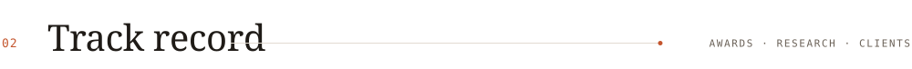
</picture>

  <a href="https://gdg.community.dev/events/details/google-gdg-cloud-sarajevo-presents-132-nd-event-sports-analytics-hackathon-1/">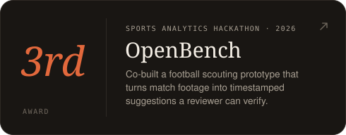</a>
  <a href="https://acmwsarajevo.acm.org/womencourage-2026-sophia-antipolis-france/1913/">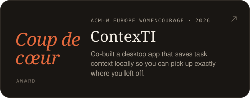</a>
  <a href="https://news.ius.edu.ba/en/news/fens-graduation-projects-exhibition-2026-showcases-student-innovation-and-engineering">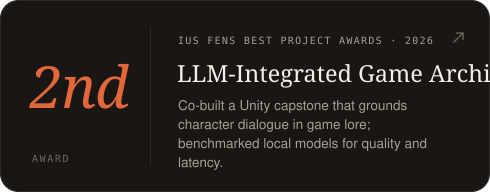</a>
  <a href="https://womencourage.acm.org/2026/index.php/poster-session/">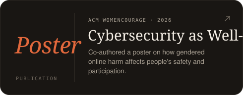</a>

  
  <a href="https://www.rehabilitacija.ba/">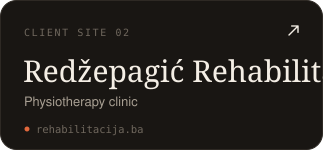</a>
  <a href="https://imblitz-gebaeudereinigung.de/">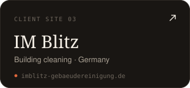</a>

 

<picture>
  <source media="(prefers-color-scheme: dark)" srcset="./assets/h-stack-dark.svg">
  
</picture>

  

 

<picture>
  <source media="(prefers-color-scheme: dark)" srcset="./assets/h-activity-dark.svg">
  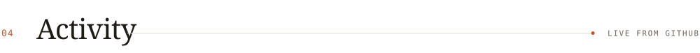
</picture>

  

  <picture>
    <source media="(prefers-color-scheme: dark)" srcset="https://raw.githubusercontent.com/hsmoviich/hsmoviich/output/snake-dark.svg">
    
  </picture>

 

  

