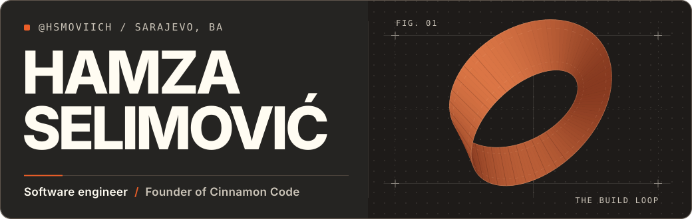

  

I’m a full-stack software engineer from Sarajevo and the founder of **Cinnamon Code**. I build web and mobile products, write open-source tools for developers, and work on the parts that make AI features useful in practice: retrieval, evaluation, and model routing.

[**LinkedIn**](https://www.linkedin.com/in/hamza-selimovic-029494289/) · [**Cinnamon Code**](https://www.linkedin.com/company/cinnamoncode/) · [**Email**](mailto:hsmovich@gmail.com)

## What I'm building

### 01 / Maestro

I packaged the [oh-my-pi](https://github.com/can1357/oh-my-pi) setup I use every day into an open-source toolkit. It installs community plugins and skills, lets you switch between Claude, GPT, or a mix, and includes **Jev Router**, the extension I wrote to match each task to a suitable model tier.

[**Source code ↗**](https://github.com/hsmoviich/omp-maestro) · [**npm ↗**](https://www.npmjs.com/package/omp-maestro) · `npx omp-maestro`

### 02 / TRAAQ

I’m the technical lead on a personal finance app we started in a 24-hour hackathon and kept building at Cinnamon Code. TRAAQ reads individual items off receipts, connects expenses to people, and lets you ask questions about your spending using saved transactions.

[**The story behind TRAAQ ↗**](https://www.linkedin.com/posts/cinnamoncode_most-budgeting-apps-can-tell-you-where-your-activity-7507151464264351744-EmpB)

## Selected work

- **OpenBench** — Co-built a football scouting prototype that turns match footage into timestamped suggestions a reviewer can verify. **3rd place**, [Sports Analytics Hackathon](https://gdg.community.dev/events/details/google-gdg-cloud-sarajevo-presents-132-nd-event-sports-analytics-hackathon-1/), 2026.
- **ContexTI** — Co-built a desktop app that saves task context locally so you can pick up where you left off. **Coup de cœur award**, [ACM-W Europe womENcourage](https://acmwsarajevo.acm.org/womencourage-2026-sophia-antipolis-france/1913/), 2026.
- **LLM-Integrated Game Architecture** — Co-built a Unity capstone that grounds character dialogue in game lore. We benchmarked local models for response quality and latency. **2nd place**, [IUS FENS Best Project Awards](https://news.ius.edu.ba/en/news/fens-graduation-projects-exhibition-2026-showcases-student-innovation-and-engineering), 2026.
- **Cybersecurity as Well-being** — Co-authored [an ACM womENcourage poster](https://womencourage.acm.org/2026/index.php/poster-session/) on how gendered online harm affects people’s safety and participation.

**Selected websites:** [Villa City](https://villacity.ba/) · [Redžepagić Rehabilitacija](https://www.rehabilitacija.ba/) · [IM Blitz Gebäudereinigung](https://imblitz-gebaeudereinigung.de/)

## What I work with

| Area | Tools and techniques |
| :--- | :--- |
| **Web & mobile** | TypeScript, React, Next.js, React Native, Expo |
| **APIs & data** | Fastify, C#/.NET, PostgreSQL, Supabase |
| **Applied AI** | Python, RAG, receipt OCR, model evaluation and routing |
| **Cloud & delivery** | Cloudflare Workers, D1, R2, Docker, GitHub Actions, Playwright |
| **Application security** | Authentication, authorization, access-control testing |
| **Design** | Figma, interface prototyping, motion graphics |

BSc in Software Engineering · International University of Sarajevo
